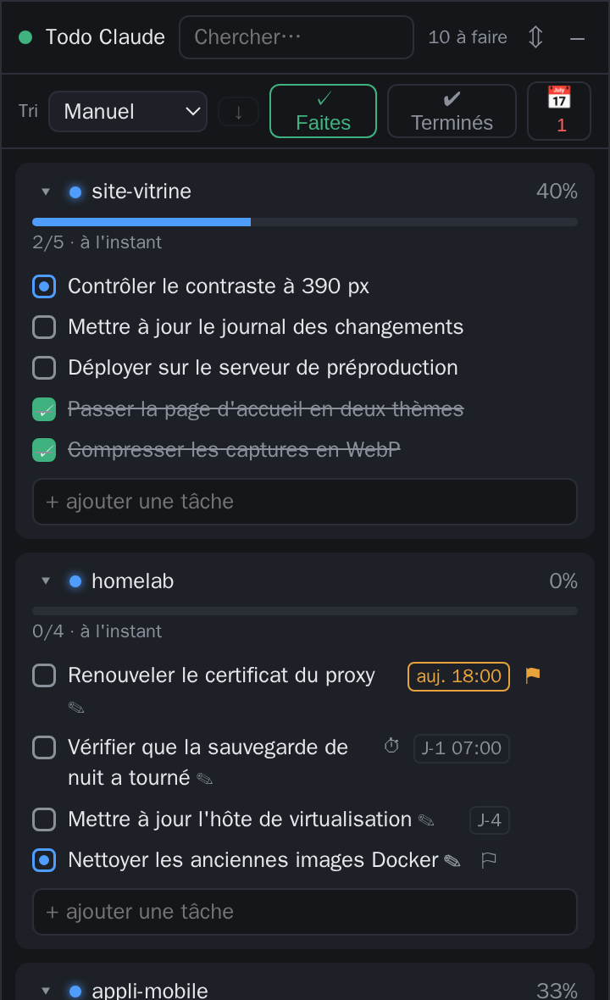
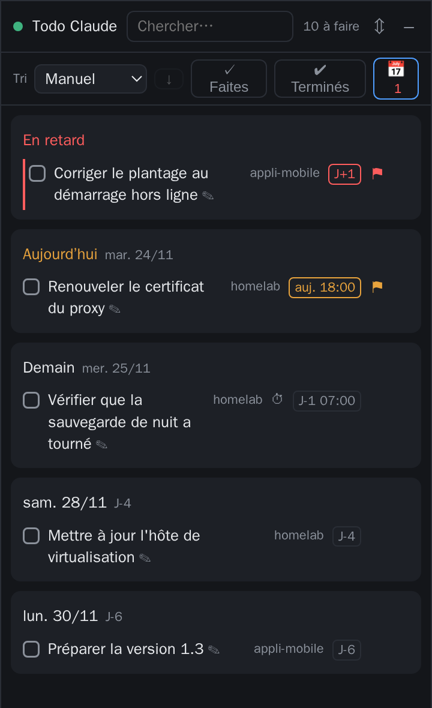
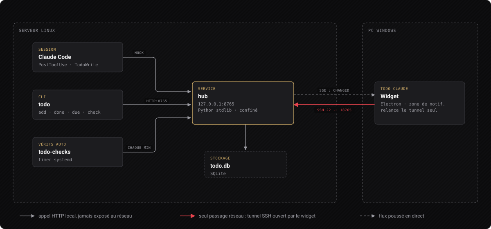
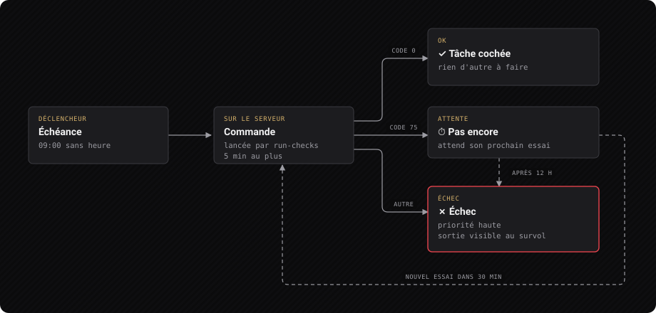

# zyphro-todo


Liste de tâches centrale alimentée par [Claude Code](https://code.claude.com/), affichée en temps réel dans un widget Windows.

Toutes les sessions Claude Code d'un serveur Linux y écrivent leurs étapes, rangées par projet avec un pourcentage d'avancement. Le serveur garde les tâches ; le widget, sur le PC, s'y connecte par un tunnel SSH. Rien n'est exposé sur le réseau.

## Sommaire

- [Fonctionnalités](#fonctionnalités)
- [Architecture](#architecture)
- [Prérequis](#prérequis)
- [Installation](#installation)
- [Utilisation](#utilisation)
- [Configuration](#configuration)
- [API du hub](#api-du-hub)
- [Construire le widget](#construire-le-widget)
- [Arborescence](#arborescence)
- [Sécurité](#sécurité)
- [Dépannage](#dépannage)
- [Licence](#licence)

## Fonctionnalités

- **Une todo pour tous les projets** : chaque dossier de travail est rattaché au projet de plus long préfixe, créé au besoin d'après le nom du dossier.
- **Alimentation automatique** : un hook Claude Code pousse la liste `TodoWrite` de chaque session ; la commande `todo` sert à tout le reste (notes « à faire plus tard », statut, priorité).
- **Widget Windows** : fenêtre flottante toujours au premier plan, icône dans la zone de notification, mise à jour instantanée, recherche, tri (manuel, importance, création, échéance), glisser-déposer entre projets.
- **Priorités** : basse, normale, haute, urgente.
- **Échéances** : badge J-x gris, orange le jour même, rouge une fois dépassée ; vue calendrier ; bulle Windows à l'échéance (9 h sans heure précise).
- **Vérifications automatiques** : une commande attachée à une tâche datée coche la tâche toute seule quand elle réussit.
<p align="center">
  
  &nbsp;&nbsp;
  
</p>
<p align="center"><sub>Vue liste et vue calendrier, avec des données de démonstration.</sub></p>

- **Nettoyage** : une tâche faite disparaît du widget après 7 jours ; d'ici là, le bouton « ✓ Faites » l'affiche ou la masque (masquée par défaut, choix mémorisé, compteurs inchangés).

## Architecture



- **hub** (`hub/hub.py`) : service HTTP en Python, bibliothèque standard seulement, base SQLite. Écoute sur `127.0.0.1` uniquement. Pousse les changements au widget par Server-Sent Events.
- **hook** (`bin/todo-hook.py`) : hook `PostToolUse` sur `TodoWrite`. Délai court, toute erreur ignorée : il ne bloque jamais Claude Code.
- **CLI** (`bin/todo`) : ajoute, modifie et lance les vérifications.
- **widget** (`widget/`) : appli Electron. Ouvre lui-même le tunnel `ssh -L 18765:127.0.0.1:8765` et le relance s'il tombe.

## Prérequis

| Côté | Il faut |
|---|---|
| Serveur | Linux avec systemd (services utilisateur), Python 3.9 ou plus, un serveur SSH. Claude Code pour l'alimentation automatique (facultatif : la CLI suffit). |
| PC | Windows 10 ou 11 (x64), client OpenSSH (fourni avec Windows), une clé SSH acceptée par le serveur, sans phrase de passe ou chargée dans l'agent SSH. |
| Construction du widget | Python 3 avec les paquets `ziglang` et `Pillow`, et le zip officiel d'Electron pour `win32-x64`. Pas besoin de Node.js ni de Windows. |

## Installation

### 1. Serveur : hub et CLI

Les unités systemd fournies supposent le dépôt dans `~/dev/zyphro-todo` : sinon, corriger les chemins `ExecStart` dans `systemd/*.service`.

```bash
git clone https://github.com/Zyphro3D/zyphro-todo.git ~/dev/zyphro-todo
cd ~/dev/zyphro-todo
mkdir -p ~/.local/share/todo-hub ~/.local/bin ~/.config/systemd/user
ln -s "$PWD/bin/todo" ~/.local/bin/todo
cp systemd/todo-hub.service systemd/todo-checks.* ~/.config/systemd/user/
systemctl --user daemon-reload
systemctl --user enable --now todo-hub.service todo-checks.timer
loginctl enable-linger "$USER"     # garder les services sans session ouverte
```

Vérifier :

```bash
todo add "Premier essai" -p test && todo list -p test
```

### 2. Serveur : hook Claude Code

Ajouter dans `~/.claude/settings.json` (fusionner avec les hooks existants) :

```json
{
  "hooks": {
    "PostToolUse": [
      {
        "matcher": "TodoWrite",
        "hooks": [
          { "type": "command", "command": "python3 ~/dev/zyphro-todo/bin/todo-hook.py", "timeout": 5 }
        ]
      }
    ]
  }
}
```

Quand l'outil `TodoWrite` n'est pas disponible dans une session, Claude peut appeler la CLI `todo` directement. Une consigne dans `~/.claude/CLAUDE.md` suffit, par exemple : « Dès qu'un travail dépasse 2 étapes, enregistrer les étapes avec `todo add`, puis `todo doing` et `todo done` au fil de l'eau ».

### 3. PC : widget

1. Lancer `TodoClaude-Setup.exe` (voir [Construire le widget](#construire-le-widget)). L'installation se fait sans droits administrateur dans `%LOCALAPPDATA%\TodoClaude`, avec des raccourcis sur le Bureau et dans le menu Démarrer et une entrée dans « Applications installées ». Si une ancienne copie tourne, l'installateur l'arrête et reprend son réglage « Lancer avec Windows ».
2. Déclarer le serveur dans `%USERPROFILE%\.ssh\config` sous l'alias `todo-server` (ou un autre alias, voir [Configuration](#configuration)) :

   ```
   Host todo-server
       HostName 192.0.2.10
       User moi
       IdentityFile ~/.ssh/id_ed25519
   ```

3. Lancer « Todo Claude ». Le point en haut à gauche passe au vert quand le tunnel est ouvert.

Paquet portable sans installateur : extraire `TodoClaude-win.zip` et lancer `TodoClaude.exe`.

Désinstallation : « Applications installées », ou le raccourci du menu Démarrer. Les réglages sont gardés, sauf si la case prévue est cochée.

## Utilisation

```text
todo add "texte" ["texte 2" …] [-p PROJET] [--prio basse|normale|haute|urgente]
         [--due DATE [--at HH:MM]] [--check "commande"]
todo list [-p PROJET]                     tâches ouvertes
todo cal                                  tâches datées, par échéance
todo doing|done|reopen|drop ID|texte      changer le statut
todo prio NIVEAU ID|texte                 changer la priorité
todo due ID|texte DATE|aucune [--at HH:MM] [--check "commande"|--check ""]
todo check ID|texte                       lancer la vérification maintenant
todo move ID|texte -p PROJET              déplacer vers un autre projet
todo project create|rename|merge|close|reopen|link NOM [CIBLE|DOSSIER]
```

- **Projet** : le dossier courant par défaut, ou `-p NOM`.
- **Désigner une tâche** : par son numéro (`42`) ou par un morceau de son titre.
- **DATE** : `aujourdhui`, `demain`, `apres-demain`, `+3` (jours), `lundi`…`dimanche` (le prochain), `28/10`, `28/10/2026`, `2026-10-28`.
- `todo --help` et `todo <commande> --help` détaillent les options.

Exemples :

```bash
todo add "Relire la PR" "Mettre à jour la doc" -p mon-projet
todo doing "Relire"
todo done 42
todo add "Renouveler le certificat" --prio haute --due vendredi --at 9:00
```

### Sessions Claude Code

Les tâches d'une session (`TodoWrite`) sont fusionnées avec celles du projet : une tâche ouverte du même titre est reprise au lieu d'être recréée. Une tâche retirée de la liste de la session sans être faite passe en « abandonnée ». Une session est « active » si elle a écrit depuis moins de 15 minutes.

### Vérifications automatiques

Une tâche datée peut porter une commande (`--check`). À l'échéance, `todo run-checks` (lancé chaque minute par le timer `todo-checks`) l'exécute sur le serveur, avec un délai maximal de 5 minutes :



| Code de sortie | Effet |
|---|---|
| 0 | Tâche cochée. |
| 75 | Pas encore : nouvel essai 30 minutes plus tard ; échec au bout de 12 h. |
| autre | Échec : la tâche passe en priorité haute. La sortie s'affiche au survol du ✗ ; un clic relance. |

Sans heure, la vérification part à 9 h. Exemple : prévenir quand un site répond.

```bash
todo add "Site en ligne" --due demain --check "curl -fsS -o /dev/null https://exemple.fr || exit 75"
```

## Configuration

**Serveur**, variables d'environnement du hub (à poser dans l'unité systemd) :

| Variable | Défaut | Rôle |
|---|---|---|
| `TODO_DB` | `~/.local/share/todo-hub/todo.db` | Base SQLite. |
| `TODO_PORT` | `8765` | Port d'écoute, toujours sur `127.0.0.1`. La CLI et le hook appellent `8765` : les modifier aussi en cas de changement. |

**Widget** : `%APPDATA%\zyphro-todo-widget\config.json`, créé au premier lancement. Fermer le widget avant de le modifier.

| Clé | Défaut | Rôle |
|---|---|---|
| `sshHost` | `todo-server` | Alias SSH (ou `utilisateur@hôte`) du serveur. |
| `sshKey` | vide | Chemin d'une clé privée, si l'alias SSH ne la donne pas. |
| `hubPort` | `8765` | Port du hub côté serveur. |
| `bounds` | 340 × 560 | Position et taille de la fenêtre, mémorisées. |

## API du hub

HTTP sur `127.0.0.1:8765`, corps et réponses en JSON. Utile pour brancher un autre client.

| Méthode | Chemin | Rôle |
|---|---|---|
| GET | `/api/state` | Projets et tâches. |
| GET | `/events` | Flux Server-Sent Events : `changed` à chaque modification. |
| GET | `/api/checks/due` | Vérifications arrivées à échéance. |
| POST | `/api/task` | Créer : `project`, `title`, `cwd`, `priority` (1 à 4), `due`, `check`. |
| POST | `/api/task/<id>` | Modifier : `status` (`todo`, `doing`, `done`, `dropped`), `title`, `priority`, `due`, `check`. |
| POST | `/api/task/<id>/move` | Déplacer : `project_id`, `before_id`. |
| POST | `/api/task/<id>/check` | Résultat d'une vérification : `code`, `out`. |
| POST | `/api/sync` | Liste d'une session Claude Code : `session_id`, `cwd`, `todos`. |
| POST | `/api/project` | Opération sur un projet : `name`, `op`, `arg`. |
| POST | `/api/projects/order` | Ordre d'affichage : `ids`. |

Exemple :

```bash
curl -s -X POST http://127.0.0.1:8765/api/task \
  -H 'Content-Type: application/json' -d '{"project": "test", "title": "Depuis curl"}'
```

## Construire le widget

La construction se fait sous Linux : rien n'est compilé côté appli, Electron est repris tel quel.

1. Télécharger le zip officiel d'Electron pour `win32-x64` depuis les [versions publiées d'Electron](https://github.com/electron/electron/releases) et l'enregistrer sous `build/electron.zip`.
2. Préparer un Python avec les outils :

   ```bash
   python3 -m venv ~/.venvs/todo-build && ~/.venvs/todo-build/bin/pip install ziglang Pillow
   ```

3. Construire :

   ```bash
   TODO_CC_PY=~/.venvs/todo-build/bin/python python3 build.py
   ```

Résultat dans `dist/` :

- `TodoClaude-Setup.exe` : installateur, un petit programme C (`installer/setup.c`, compilé par zig) suivi du paquet ;
- `TodoClaude-win.zip` : paquet portable (dossier `TodoClaude/`, scripts d'installation dans `_install/`).

La version vient de `widget/package.json`.

## Arborescence

```
bin/todo                CLI
docs/                   images du README
bin/todo-hook.py        hook Claude Code (PostToolUse sur TodoWrite)
hub/hub.py              service central (HTTP + SQLite)
systemd/                unités utilisateur : hub, vérifications (service + timer)
widget/                 appli Electron (main.js, preload.js, renderer.js, index.html)
installer/              installateur Windows : stub C, scripts PowerShell
build.py                assemble dist/TodoClaude-Setup.exe et dist/TodoClaude-win.zip
```

## Sécurité

- Le hub n'écoute que sur `127.0.0.1` et ne demande **aucune authentification** : tout compte local du serveur peut lire et écrire les tâches. Il est fait pour un serveur à un seul utilisateur.
- Les commandes de vérification sont exécutées par `todo run-checks`, avec les droits de l'utilisateur, hors du confinement du hub. Toute personne qui peut écrire dans le hub peut donc y déposer une commande qui sera lancée : réservez le serveur à vous seul, ou retirez le timer `todo-checks` si ce n'est pas le cas.
- Le hub ne lance jamais rien lui-même et tourne confiné par systemd (`ProtectSystem=strict`, écriture limitée à son dossier de données, `NoNewPrivileges`, mémoire plafonnée).
- Le widget passe uniquement par SSH, en mode non interactif (`BatchMode=yes`) : aucun mot de passe n'est stocké, l'accès repose sur votre clé.

## Dépannage

| Symptôme | Piste |
|---|---|
| `todo-hub injoignable` | `systemctl --user status todo-hub` puis `journalctl --user -u todo-hub`. |
| Point du widget pas vert (survol : « hors ligne ») | Tester dans PowerShell `ssh todo-server true` : il doit réussir sans rien demander. |
| Les tâches de Claude Code n'arrivent pas | Vérifier le hook dans `~/.claude/settings.json` ; tester `todo list` depuis le même dossier. |
| Une vérification ne part pas | `systemctl --user list-timers todo-checks.timer` ; `todo check ID` pour la lancer à la main. |
| Services arrêtés après déconnexion | `loginctl enable-linger "$USER"`. |

## Licence

[PolyForm Noncommercial 1.0.0](LICENSE.md) : usage personnel, étude et modification libres ; usage commercial interdit.
